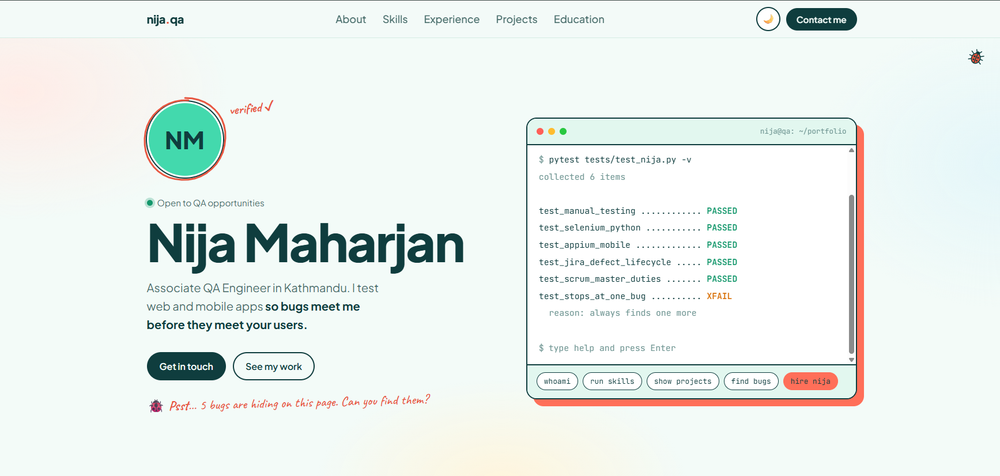

# Nija Maharjan | QA Portfolio

Personal portfolio website of **Nija Maharjan**, Associate QA Engineer based in Kathmandu, Nepal.

**Live site:** https://nijamaharjan.com.np



## Features

- Interactive terminal with QA-themed commands (try `hire nija`)
- Bug hunt game: find the 5 bugs hidden on the page
- Light and dark mode
- Fully responsive, from small phones to large desktops

## Built with

- HTML5
- CSS3 (custom properties, Flexbox, Grid, media queries)
- Vanilla JavaScript
- Fonts: Plus Jakarta Sans, Caveat and JetBrains Mono (Google Fonts)
- Hosted on GitHub Pages

## Project structure

```
PortfolioWebsite/
├── index.html          Page content
├── css/
│   └── portfolio.css   Styles, themes and responsive layout
├── js/
│   └── portfolio.js    Theme switch, menu, terminal and bug hunt
└── images/
    └── screenshot.png  Preview used in this README
```

## Run locally

Open `index.html` in a browser, or use the **Live Server** extension in VS Code.

## Contact

- Email: nijamaharjan13@gmail.com
- LinkedIn: https://www.linkedin.com/in/nija-maharjan-b0641a356
- GitHub: https://github.com/nija616